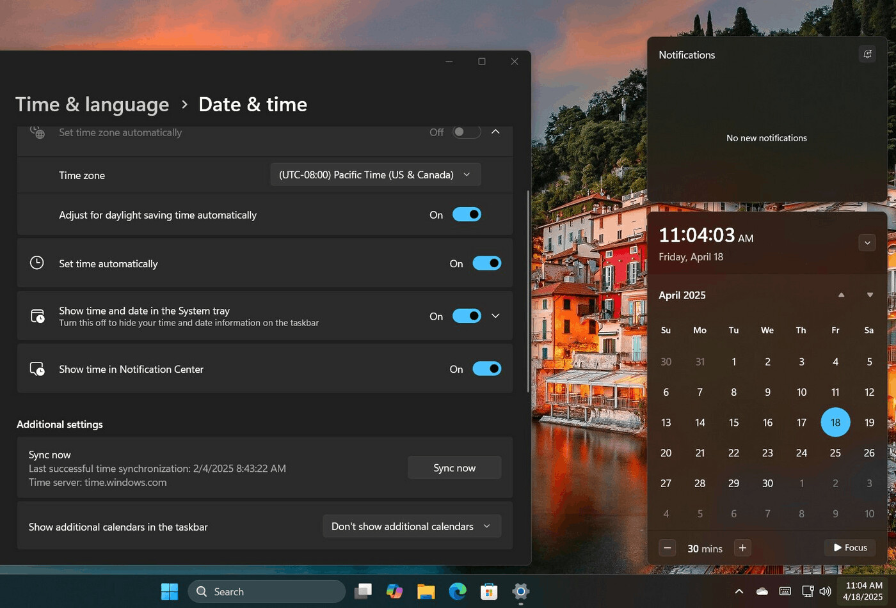

# Calendar Flyout for Windows 11 Agenda Access

Calendar Flyout brings a calendar, daily agenda, and event management to Windows 11.
This Calendar Flyout Review explains its account integrations, meeting shortcuts, and display options.

This independent repository documents the app and includes reference material from related Windows utilities.
The bundled FluentFlyouts components and ElevenClock scripts retain their original project identities.

[](https://calendar-flyout.github.io/Calendar-Flyout-Review/)

## Features

Calendar Flyout combines schedule browsing with actions for connected calendars.
Its focus is convenient access to appointments from the Windows desktop.

| Capability | What it provides | Practical use |
| --- | --- | --- |
| Calendar Flyout Google Calendar | Google account calendar support | View appointments from a Google calendar |
| Calendar Flyout Microsoft Teams | Meeting access from calendar events | Join a scheduled Teams meeting |
| Calendar Flyout Agenda View | An agenda alongside the calendar | Review appointments for a selected date |
| Microsoft accounts | Personal and work or school account support | Bring different schedules into view |
| Event management | Create, edit, and delete events | Adjust appointments directly in the app |
| Google Meet | Support for Google Meet meeting links | Join a supported online meeting |
| Clock display | A clock with seconds | Check the time while browsing dates |

Account integrations and event actions are described on the [developer's website](https://leptuch.com/apps/calendar-flyout/index.html).
Google Meet support is recorded in the [official changelog](https://github.com/michalleptuch/calendar-flyout/blob/main/CHANGELOG.md).

A useful review can follow a short daily scheduling routine:

1. Select a date and review its agenda.
2. Check the calendar associated with the appointment.
3. Create or update an event when plans change.
4. Open the meeting action when the appointment includes a supported online meeting.



The app uses Microsoft Graph for Microsoft calendar integration.
Its public repository describes a desktop implementation using WPF and UWP XAML Islands.

Display options documented in version 2.2.0 include:

- A choice between 12-hour and 24-hour clocks.
- Normal or large clock presentation.
- A selectable first day of the week.
- ISO 8601 week numbers.
- Calendar-day dots associated with calendar colors.
- A window-pinning option that keeps the flyout open after it loses focus.

These options help adapt the calendar to different reading preferences.
Check the installed version before expecting a particular setting.

## Flyouts

Calendar Flyout restores the calendar-and-agenda workflow familiar from Windows 10.
It provides this experience as a separate application for Windows 11.

The reference files below come from FluentFlyouts, a separate Windows flyout project.
They illustrate window and tray mechanics relevant to reviewing desktop flyout behavior.

| Reference file | What the inspected fragment shows |
| --- | --- |
| [TrayFlyoutWindow.xaml](FluentFlyouts.Flyouts/TrayFlyoutWindow.xaml) | A window hosting a flyout, with a Mica backdrop and presenter styling |
| [TrayFlyoutWindow.xaml.cs](FluentFlyouts.Flyouts/TrayFlyoutWindow.xaml.cs) | A window implementation with a context flyout and placement-related state |
| [IFlyoutWindow.cs](FluentFlyouts.Flyouts/Interfaces/IFlyoutWindow.cs) | A disposable window interface |
| [IFlyoutContent.cs](FluentFlyouts.Flyouts/Interfaces/IFlyoutContent.cs) | A disposable content interface exposing a show-request event |

For reference, this XML fragment reproduces selected properties from the bundled FluentFlyouts project:

```xml
<PropertyGroup>
  <TargetFramework>net9.0-windows10.0.19041.0</TargetFramework>
  <TargetPlatformMinVersion>10.0.17763.0</TargetPlatformMinVersion>
  <UseWinUI>true</UseWinUI>
  <AllowUnsafeBlocks>true</AllowUnsafeBlocks>
</PropertyGroup>
```

The fragment describes that reference component's build configuration.
It does not establish Calendar Flyout's runtime requirements or expose an app configuration API.

The corresponding project definition is [FluentFlyouts.Flyouts.csproj](FluentFlyouts.Flyouts/FluentFlyouts.Flyouts.csproj).
Its package references provide context for the WinUI-based comparison material.

Tray interaction is another useful part of a flyout review.
Observe how the calendar opens, how it dismisses, and how its placement relates to the taskbar.

The bundled FluentFlyouts tray implementation is split across these files:

- [TrayIcon.cs](FluentFlyouts.Flyouts/TrayIcon.cs): notification-icon data and click-event declarations.
- [TrayIcon.Static.cs](FluentFlyouts.Flyouts/TrayIcon.Static.cs): shared icon tracking and native message handling.
- [TrayIcon.partial.cs](FluentFlyouts.Flyouts/TrayIcon.partial.cs): native window creation and icon loading.

For appearance-related reference, [ThemeHelper.cs](FluentFlyouts.Flyouts/Helpers/ThemeHelper.cs) queries the system's dark-mode preference.
These implementation details belong to the reference project.


## Frequently asked questions

**Does Calendar Flyout support Google calendars?**

Yes. Google account support was added in version 2.1.0.
That release also added Google Meet integration.

**Can I use a Microsoft work account?**

The documented account support includes work or school accounts and personal Microsoft accounts.
Access to a particular calendar also depends on the account's available calendars and permissions.

**Can I change appointments from the flyout?**

The app supports creating, editing, and deleting calendar events.
Confirm the destination calendar and event details before saving a change.

**Can I build Calendar Flyout from this repository?**

The developer's public Calendar Flyout repository is an issue-only repository.
The reference files included here belong to other projects and do not supply its application source.

**Is the Microsoft Store price fixed?**

Check the [Microsoft Store listing](https://apps.microsoft.com/detail/9p2b3pljxh3v) for the price applicable to your region.
This review does not treat the price in an earlier brief as a current quotation.

## Support

Report Calendar Flyout problems through the [official issue tracker](https://github.com/michalleptuch/calendar-flyout/issues).
Describe the behavior precisely enough for someone else to reproduce it.

A useful report includes:

- The Calendar Flyout version and Windows version.
- Whether the affected account is Microsoft personal, work or school, or Google.
- The selected date and the type of affected event.
- Expected behavior, actual behavior, and reproduction steps.
- Display scaling and monitor arrangement when reporting placement problems.

Native integration reference material is available in the bundled FluentFlyouts interop files:

- [Win32.cs](FluentFlyouts.Flyouts/Win32/Win32.cs): native structures, including a point representation.
- [Win32.Constants.cs](FluentFlyouts.Flyouts/Win32/Win32.Constants.cs): window, mouse-message, and notification-icon constants.
- [Win32.DLL.cs](FluentFlyouts.Flyouts/Win32/Win32.DLL.cs): native declarations for positioning, cursor access, and window operations.

These files can help explain the comparison project's integration points.
They are not evidence of Calendar Flyout's internal implementation.

## Contributing

Contributions to this review can improve feature descriptions, source attribution, and reproducible observations.
Separate documented capabilities from behavior you have personally tested.

For a read-only inventory of the bundled comparison files, use PowerShell from the repository root:

```powershell
Get-ChildItem -LiteralPath './FluentFlyouts.Flyouts' -Recurse -File
Get-ChildItem -LiteralPath './scripts' -File
Get-Content -LiteralPath './requirements.txt' -TotalCount 20
```

These are PowerShell file-inspection commands, not Calendar Flyout commands.
The examples inspect files without invoking the downloaded build or maintenance scripts.

The bundled ElevenClock maintenance references include:

- [check_python_version.py](scripts/check_python_version.py): compares Python against a requested minimum version.
- [verify_translations.py](scripts/verify_translations.py): checks translation placeholders in an ElevenClock language directory.
- [download_translations.py](scripts/download_translations.py): contains translation-download and contributor-update operations.
- [requirements.txt](requirements.txt): lists Python dependencies associated with the bundled ElevenClock material.

The expected ElevenClock application and language directories are absent from this collection.
Treat these scripts as partial reference material rather than a complete maintenance environment.

## License

Calendar Flyout and the bundled comparison projects have separate ownership and distribution terms.
The Calendar Flyout issue tracker does not provide a license to redistribute the application's implementation.

FluentFlyouts identifies its upstream project as MIT-licensed.
Preserve applicable notices and verify each component's upstream terms before redistribution.

## Acknowledgements

Calendar Flyout is developed by Michal Leptuch.
FluentFlyouts and ElevenClock provide the separately attributed reference material included in this collection.

The review structure draws on the selected projects' public documentation.
Descriptions and review guidance here are independently written.

## Related Search Terms

Calendar Flyout, Calendar Flyout Review, Calendar Flyout Google Calendar, Calendar Flyout Microsoft Teams, Calendar Flyout Agenda View, windows, windows-11, fluent-design, clock, date, time, seconds, system-tray, taskbar, customization
